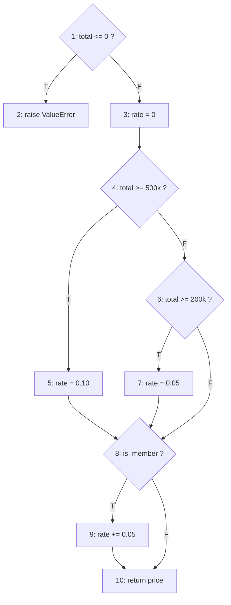
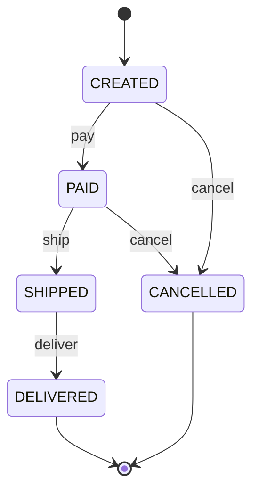

# Tugas Sesi 10 – Procedural & OO Test Suite

Topic: Order & discount system (e-commerce).
Files: `discount.py`, `order.py`, `test_discount.py`, `test_order.py`

---

## Part 1 – Procedural: `calculate_final_price(total, is_member)`

### Control Flow Graph

Nodes: 1 = `if total <= 0` (D1), 2 = `raise`, 3 = `rate = 0.0`, 4 = `if total >= 500k` (D2),
5 = `rate = 0.10`, 6 = `elif total >= 200k` (D3), 7 = `rate = 0.05`,
8 = `if is_member` (D4), 9 = `rate += 0.05`, 10 = `return`



### Cyclomatic complexity V(G)

Three equivalent calculations:

- Predicate nodes + 1 = 4 (D1, D2, D3, D4) + 1 = **5**
- E − N + 2: the graph has a terminal `raise` node (2), so add a virtual exit node 11 with edges 2→11 and 10→11. Then E = 14, N = 11 → 14 − 11 + 2 = **5**
- Number of regions in the planar graph = **5**

**V(G) = 5**, so at least 5 test cases are needed.

### Independent paths (basis set)

| Path | Route | Condition | Test |
|---|---|---|---|
| P1 | 1-2 | total ≤ 0 | `test_p1_invalid_total` |
| P2 (baseline) | 1-3-4-5-8-10 | ≥500k, non-member | `test_p2_big_total_non_member` |
| P3 | 1-3-4-5-8-9-10 | ≥500k, member | `test_p3_big_total_member` |
| P4 | 1-3-4-6-7-8-10 | 200k–499k, non-member | `test_p4_mid_total_non_member` |
| P5 | 1-3-4-6-8-10 | <200k, non-member | `test_p5_small_total_non_member` |

Each path after the baseline flips exactly one decision, so each introduces a new edge.

Extra tests: boundary values (1, 199,999, 499,999) and the small-total + member combination.

---

## Part 2 – OO: `Order` state machine

### States
`CREATED` (initial), `PAID`, `SHIPPED`, `DELIVERED` (final), `CANCELLED` (final)



### Transition table (✗ = raises `InvalidTransitionError`)

| State \ Event | pay | ship | deliver | cancel |
|---|---|---|---|---|
| CREATED | PAID | ✗ | ✗ | CANCELLED |
| PAID | ✗ | SHIPPED | ✗ | CANCELLED (✗ in `ExpressOrder`) |
| SHIPPED | ✗ | ✗ | DELIVERED | ✗ |
| DELIVERED | ✗ | ✗ | ✗ | ✗ |
| CANCELLED | ✗ | ✗ | ✗ | ✗ |

20 state/event pairs: 5 valid, 15 invalid. All 20 are tested (`test_valid_transition`, `test_invalid_transition`).
Invalid tests also assert that the state is **unchanged** after the failed event.

### Inheritance & polymorphism (`ExpressOrder(Order)`)

| Behavior | Test |
|---|---|
| `isinstance(ExpressOrder, Order)` (substitutability) | `test_express_is_an_order` |
| `shipping_fee()` overridden (10k vs 25k), `total()` inherited | `test_polymorphic_shipping_fee` |
| Inherited flow still works | `test_express_inherits_normal_flow` |
| `cancel()` overridden: blocked in PAID | `test_express_cannot_cancel_after_payment` |
| Override delegates to `super()` in other states | `test_express_can_cancel_before_payment`, `test_express_cancel_still_blocked_from_shipped` |
| Base class contrast: normal order can cancel when PAID | `test_normal_order_can_cancel_after_payment` |

---

## Part 3 – Coverage report

Command:
```
python -m pytest --cov=discount --cov=order --cov-branch --cov-report=term-missing
```

```
Name          Stmts   Miss Branch BrPart  Cover   Missing
---------------------------------------------------------
discount.py      11      0      8      0   100%
order.py         40      0      6      0   100%
---------------------------------------------------------
TOTAL            51      0     14      0   100%
41 passed
```

### Analysis

- **Branch count matches the CFG:** `discount.py` has 4 decisions × 2 outcomes = 8 branches, all covered. This
  agrees with V(G) = 5 (the 5 basis paths reach every edge).
- **`order.py`** has 3 decisions (`amount <= 0` in `__init__`, `state not in allowed_from` in `_move`, and
  `state == PAID` in `ExpressOrder.cancel`) = 6 branches, all covered. The `_move` check is exercised from both
  sides by the 5 valid and 15 invalid transition tests, and `ExpressOrder.cancel` runs both its blocking branch
  and its `super().cancel()` branch.
- **100% ≠ bug-free.** Coverage only shows the code was executed. Quality comes from the assertions: every test
  checks a concrete expected value or exception, and invalid-transition tests also verify state is unchanged.
- **Limits:** The tests do not cover floating-point issues in `rate` (mitigated by `round`), non-numeric input
  types, or concurrency. These are outside the module's stated scope.
- **Assertion strength check:** I manually applied 7 small mutations (e.g. `>=` → `>`, `0.05` → `0.06`, surcharge
  15k → 10k, removing the Express cancel guard, allowing cancel from SHIPPED). The suite failed on all 7, so the
  assertions are effective, not just executing the code. A tool such as `mutmut` could automate this further.
